<!-- Bento tiles: drawn in bento/tiles.html, rendered to assets/bento/ by `node bento/build.mjs`.
     Each row's widths add up to 1000px of design, written here as percentages. -->

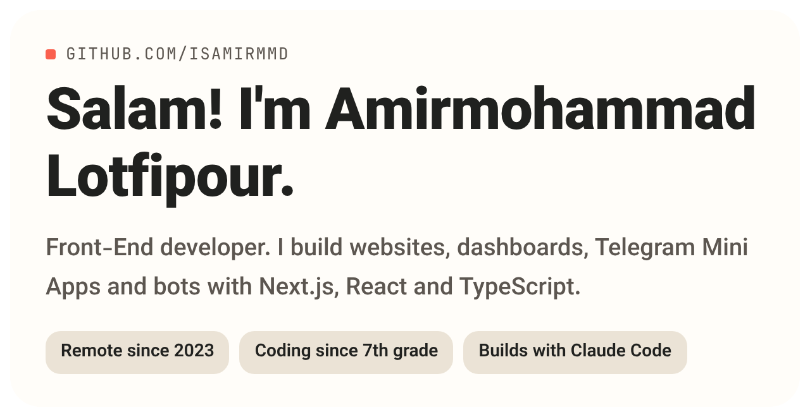 <picture><source media="(prefers-color-scheme: dark)" srcset="assets/bento/now-dark.png"/>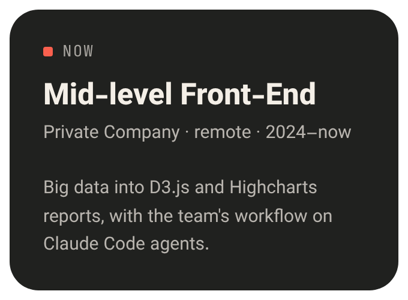</picture><a href="https://nimbyte.ir">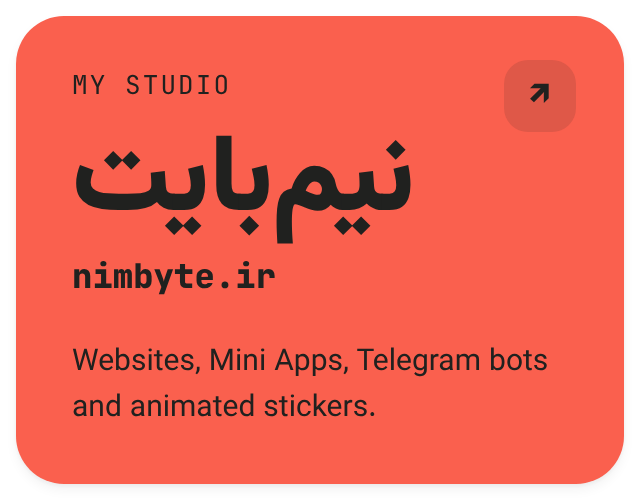</a>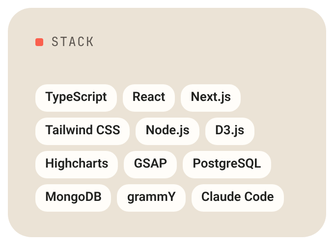 <a href="https://melting-bear.netlify.app/">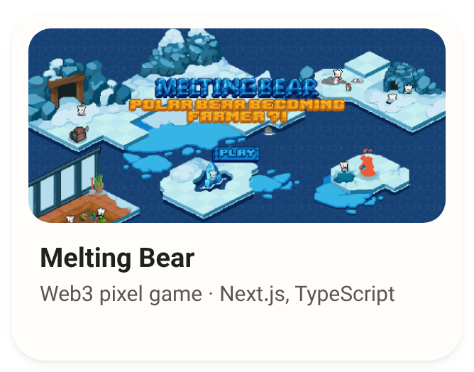</a><a href="https://t.me/hesabdarInlinebot">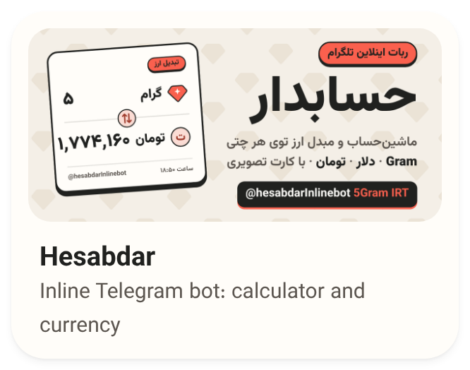</a><a href="https://attend.nimbyte.ir">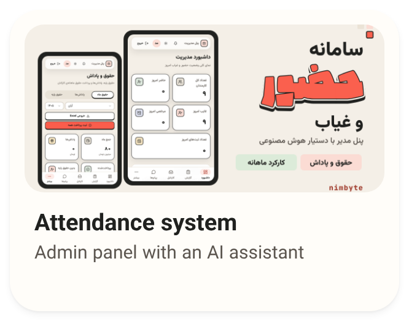</a> 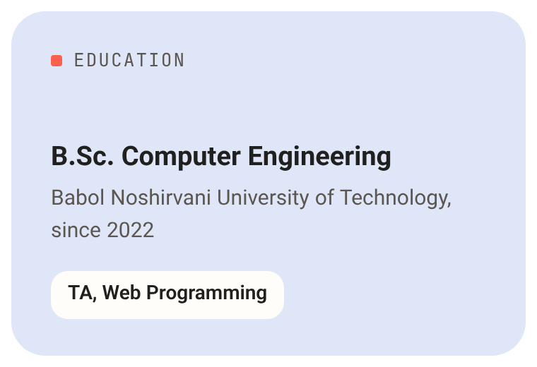 <a href="https://t.me/isAmirMmd">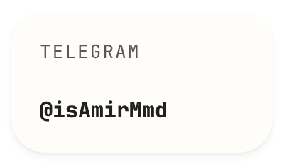</a><a href="https://t.me/nimByte">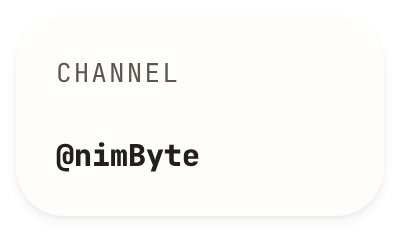</a><a href="https://www.instagram.com/nimbyte.ir/">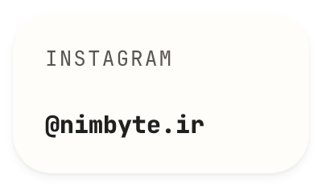</a><a href="https://linkedin.com/in/isamirmmd">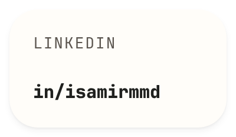</a>

 

More work on <a href="https://nimbyte.ir/portfolio">nimbyte.ir/portfolio</a> · WordPress sites in <a href="https://github.com/IsAmirMmd/wordpress-websites">wordpress-websites</a>

