<!-- Bento tiles: drawn in bento/tiles.html, rendered to assets/bento/v2/ by `node bento/build.mjs`.
     Each row's widths add up to 1000px of design, written here as percentages. -->

<a href="https://nimbyte.ir">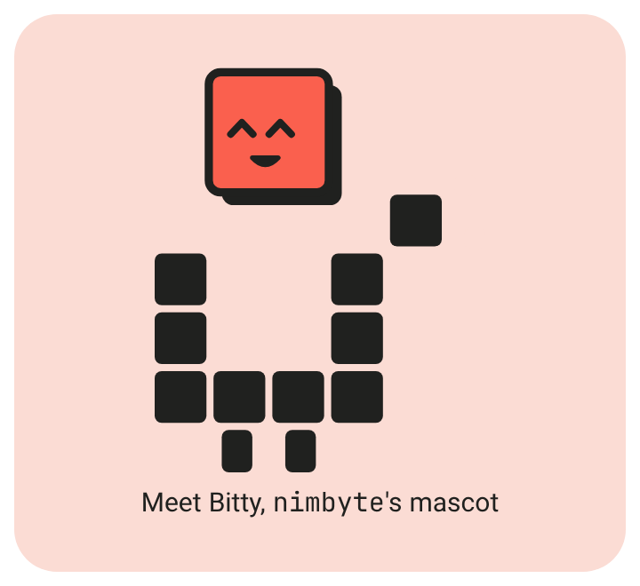</a> <picture><source media="(prefers-color-scheme: dark)" srcset="assets/bento/v2/now-dark.png"/>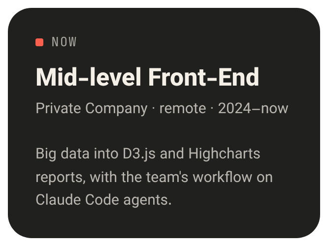</picture><a href="https://nimbyte.ir">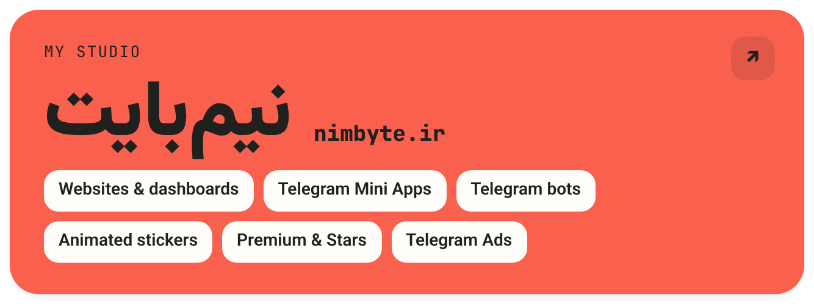</a> 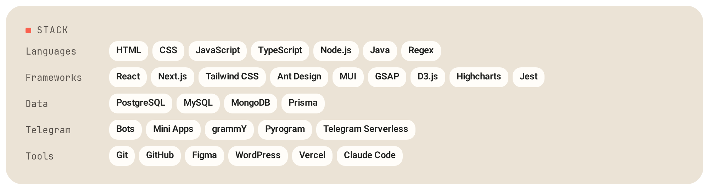 <a href="https://t.me/AdsProviderBot">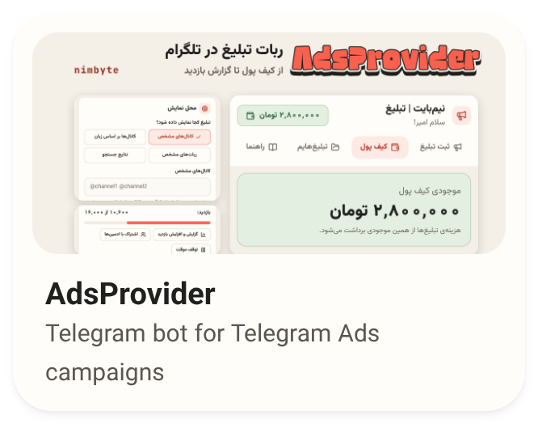</a><a href="https://nakoja.nimbyte.ir">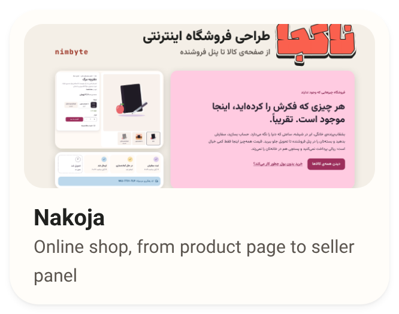</a> 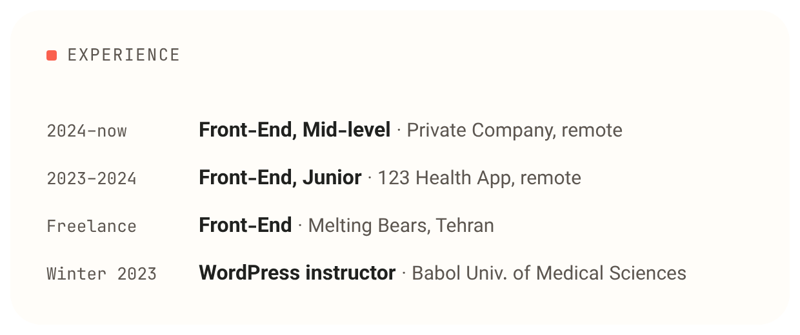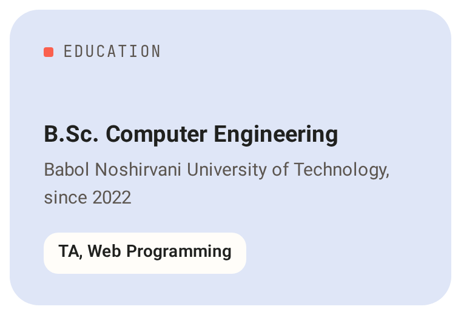 <a href="https://open.spotify.com/track/2X485T9Z5Ly0xyaghN73ed"><picture><source media="(prefers-color-scheme: dark)" srcset="assets/bento/v2/music-dark.png"/>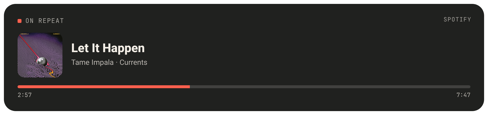</picture></a> <a href="https://t.me/isAmirMmd">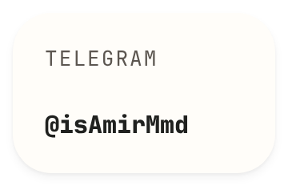</a><a href="https://t.me/nimByte">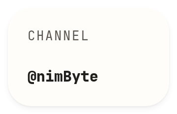</a> 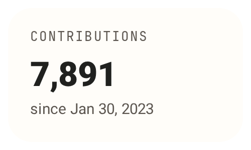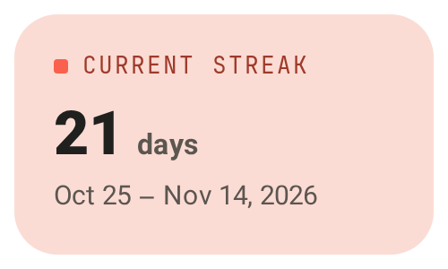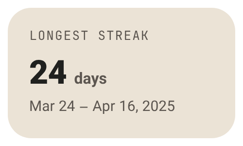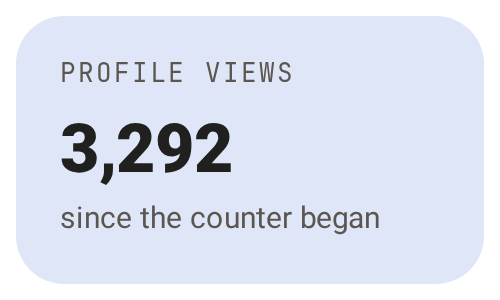 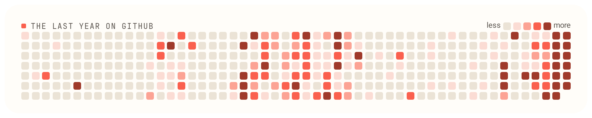

<!-- komarev counts the views; the number is drawn on the tile above by the stats workflow. -->

